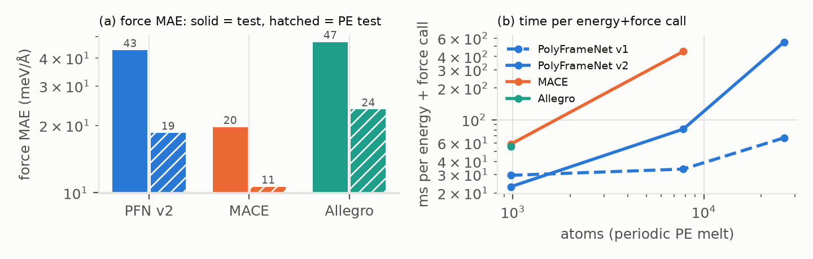

# PolyFrameNet: a polymer potential that knows what a polymer is

**Code:** https://github.com/sumedhk0/PolyFrameNet (MIT) · **Data:** OPoly26 polymer clusters, ωB97M-V/def2-TZVPD

## Problem

Polymer simulation needs quantum accuracy at the scale of tens of thousands of atoms.
General machine-learned potentials such as MACE carry equivariant tensor features on
every edge. That makes them expensive in time and memory: on a 46 GB L40S, MACE runs out
of memory on a 26k-atom polymer melt. Polymers have structure such models ignore: a few
repeating building blocks, a covalent graph that never changes, and bonded atoms that
define local directions.

## Approach

**Blocks.** PolyFrameNet reads the bond graph once and cuts it into rigid blocks: each
ring system is one block, each other heavy atom is a block, and terminal atoms join their
neighbour. The rule uses graph structure only, so the cut is unique on any fragment.

**Frames.** Each block gets orthonormal frames from its bonded atoms. Vectors expressed in
a frame are rotation-invariant, so every network is a plain MLP, with no tensor products.

**No frame selection.** Frame methods usually fail at the choice of frame: one picked by
geometry ("nearest atom") jumps and breaks energy conservation. Instead, every stage
*averages* over all frames drawn from Weisfeiler–Lehman colour classes of the bond graph.
That set is closed under rotation, reflection and relabelling, so the energy is exactly
O(3)- and permutation-invariant, and forces are exact gradients.

**Model.** A shared block encoder, 3 message-passing layers on the sparse block graph, a
learned valence prior, one 4.5 Å many-body layer, latent-charge electrostatics (Ewald) with
a dispersion tail, and charge/spin inputs. It accepts any element; only the training data
changes.

## Results

All models: the same 3,429 hydrocarbon training frames (split by MD system), the same
reference energies, and **90 min of training each on one NVIDIA L40S**. Inference was
measured in float32 on an idle L40S through ASE.

| | Test F MAE (meV/Å) | Test E MAE (meV/atom) | PE test F MAE | 1k atoms (ms/step) | 8k atoms | 26k atoms |
|---|---|---|---|---|---|---|
| **PolyFrameNet v2** | 43.4 | 1.19 | 18.5 | **23** | 81 | 551 |
| MACE | **19.7** | **0.76** | **10.7** | 58 | 448 | out of memory |
| Allegro* | 47.2 | 1.50 | 23.6 | 56 | out of memory | out of memory |
| PolyFrameNet v1 (PE only) | – | – | 13.7† | 29 | **34** | **67** |

\*Allegro trained 90 min on a laptop RTX 4080, and was timed uncompiled.
†v1 versus MACE trained on PE only: 13.71 vs 13.73 meV/Å.

- **Speed and memory.** v2 is 2.5× faster than MACE at 1k atoms and 5.5× at 8k, and still
  runs at 26k atoms, where MACE exhausts 46 GB. The PE-only v1, with no long-range terms,
  needs 3.5 GB at 26k atoms.
- **Accuracy.** With equal compute, v2's errors are about 2× MACE's. v2 plateaued after
  ~120 of its 312 epochs, so this is a capacity gap, not under-training. On polyethylene
  alone, v1 ties MACE.
- **Correctness by construction.** 81 tests check exact invariance, finite-difference
  forces and a true variant-set oracle. They pass even on chemistry the model never saw:
  ethers, amides, esters, C–Cl, CF₄, aromatic N/S rings, nitriles and ions.
- **Block registry.** For any new polymer, each building block is flagged as seen,
  similar or novel relative to the training data.

## Lessons and next steps

- **A singular frame.** One training geometry, an H at exactly 180° to a C–C bond, made a
  frame singular and wrecked a run. We found it and removed it; sin²-weighted frame
  averaging is the principled fix.
- **Closing the accuracy gap.** Next: a second many-body layer, richer frame pooling, a
  LAMMPS interface, and training on all of OPoly26.
