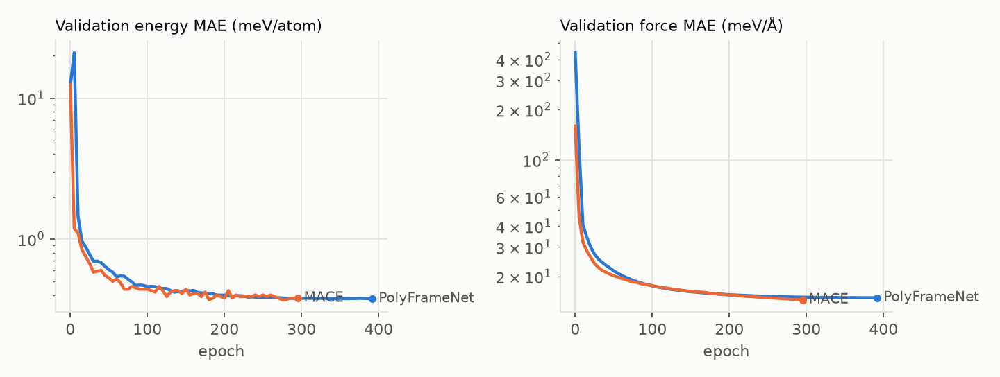
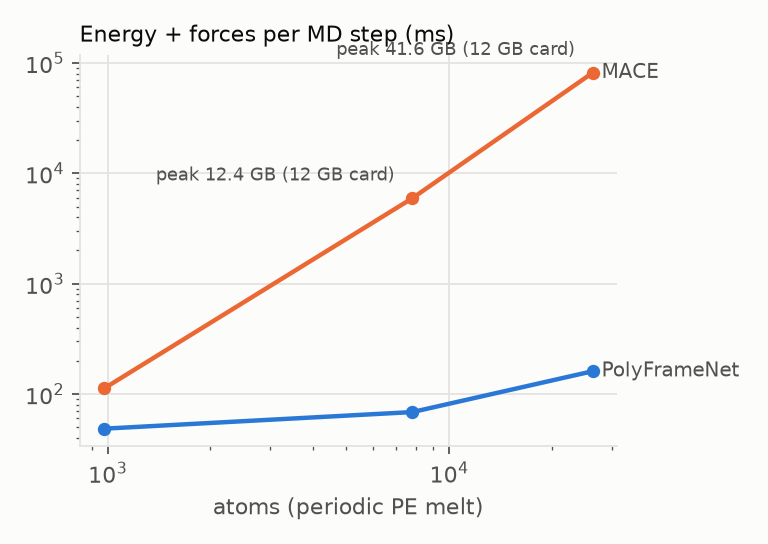
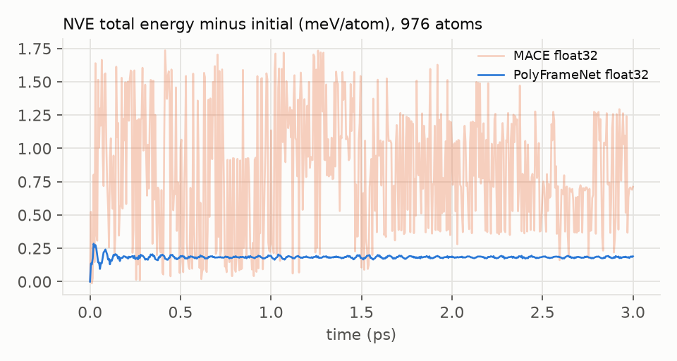
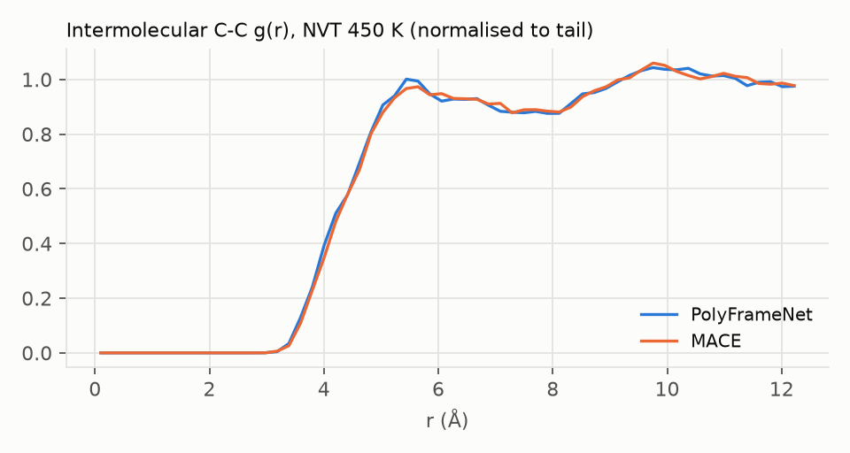

# PolyFrameNet: a block-factored interatomic potential for polyethylene

Hackathon build, 2026-10-21. Model, data pipeline, training, correctness gates and benchmarks
are all in this repository; every number below comes from a command listed under
[Reproduce](#reproduce).

## Summary

PolyFrameNet and a MACE baseline were trained on the same polyethylene subset of OPoly26,
with the same split, reference energies and loss weights, on one laptop GPU (RTX 4080 Laptop,
12 GB). The test set is 77 frames from MD systems never seen in training.

| | PolyFrameNet | MACE |
|---|---|---|
| Test energy MAE (meV/atom) | 0.33 | **0.28** |
| Test force MAE (meV/Å) | **13.71** | 13.73 |
| Test force RMSE (meV/Å) | 20.8 | **19.6** |
| Parameters | 656 k | 213 k |
| Time per MD step, 976 atoms | **48 ms** | 112 ms |
| Time per MD step, 7 808 atoms | **69 ms** | 5 950 ms |
| Peak GPU memory, 7 808 atoms | **1.1 GB** | 12.4 GB |
| NVE, 3 ps: drift (meV/atom/ps) | 0.0003 | see §4.5 |

* **Accuracy: a tie.** Forces are equal to within 0.2%. MACE's energy is 15% better.
* **Speed and memory: PolyFrameNet wins.** It is 2.3× faster at 1k atoms. At 8k atoms
  MACE outgrows the 12 GB card, pages into system RAM, and is 86× slower. PolyFrameNet runs
  26k atoms in 3.5 GB.
* **Stability.** Both models run stable NVE and NVT, and they agree on the melt structure.
* **Correctness.** All 23 gates pass: rotation, reflection, permutation, wrap,
  finite-difference forces, cutoff smoothness and the automorphism oracle.
* **The most useful negative result.** The spec's exclusion rule hides intra-chain pairs
  within L_b block hops from the non-bonded channel. In 8-minute runs it made test force
  error 3.4× worse, so the final model keeps every pair (§4.3).

## 1. What the model is

A polymer is built from a few repeating chemical units, its covalent bonds are fixed, and
the backbone gives every unit a natural local coordinate frame. Generic MLIPs (MACE, NequIP,
UMA) use none of this: they rediscover bonding from distances at every step and pay for
rotational symmetry with tensor products. PolyFrameNet uses all three facts:

| Fact | How it is used |
|---|---|
| Repeating units | The chain is cut into **blocks** of two carbons. Each block type has its own dense encoder; weights are shared across all instances. |
| Fixed covalent graph | Topology is read once from the first geometry and frozen. It decides block membership, frame atoms, chain neighbours and the valence pairs. |
| Backbone frame | Every block gets an orthonormal frame built from its own atoms. Projecting vectors into it makes them rotation invariant, so every network after that is an ordinary MLP. |

### Block dictionary (decision A)

| Type | Atoms | Slot order | Frame |
|---|---|---|---|
| `PE_mid` | `-CH2-CH2-` (6) | C1, C2, H1a, H1b, H2a, H2b | e1 = C1 to C2; e2 from the two H on C1 |
| `PE_end` | `CH3-CH2-` (7) | Cm, Cc, Hm1-3, Hc1, Hc2 | e1 = Cm to Cc; e2 from the two H on Cc |

A chain with n carbons (n even, at least 4) becomes 2 end blocks and (n-4)/2 mid blocks.

### Pipeline

```
positions, cell ──► Stage 0  topology (frozen) + radius graph (every call)
                    Stage 1  block frames F (4 variants: chain direction × mirror)
                    Stage 2  block encoder  ──► per-atom h_i, block H_I
                    Stage 3  bonded channel on the block chain ──► H'_I
                    Valence  learnable 1-2 / 1-3 / 1-4 distance terms
                    Stage 4  one radius-graph pass, frame-projected moments, body order 4
                    Stage 5  long-range hook (returns 0 for PE)
                    Stage 6  per-atom readout, E = Σ eps_i + Σ E0[Z_i];  F = -dE/dr (autodiff)
```

Code: `src/frame_potential/model.py` (stages 1-6), `topology.py` and `batch.py` (stage 0).

### Stage 0: graphs (`topology.py`, `batch.py`)

* **Bonds.** Read once from distances: C-C < 1.85 Å, C-H < 1.35 Å. A KD-tree does the search,
  with periodic boxes as needed. The structure is accepted only if every C has 4 neighbours
  and at most 2 carbon neighbours, every H has one C, and the carbon graph is a set of
  paths. Anything else raises `TopologyError` and the frame is dropped: rings, branches,
  radicals, unsaturation, and a chain bonded to its own periodic image.
* **Blocks.** Each chain is walked from one end and cut into C2 pairs. Hydrogens are put
  into slots in arbitrary (index) order. The model is invariant to that order (Stage 2), so
  nothing depends on it.
* **Block graph.** Consecutive blocks along a chain (hop 1), plus second neighbours (hop 2).
* **Radius graph.** Rebuilt from the current positions on every call, never cached. It
  returns integer triples (i, j, S), where S is a lattice-image shift. Edge vectors are then
  computed inside autograd as `r_j - r_i + S @ cell`, so forces (and stress) are exact
  derivatives. Backends:
  * one masked all-pairs pass for cluster batches;
  * vesin for periodic systems;
  * a 27-image brute-force reference used only in tests.

### Stage 1: frames (`block_frames`)

For a hydrogen h on the frame carbon c, take u_h = unit(r_h - r_c), then:

```
e1 = unit(r_C2 - r_C1)
s  = Σ_h [u_h - (u_h·e1) e1]      (perpendicular parts, summed over the two H)
e2 = unit(s)
e3 = e1 × e2
o  = centroid of the block
```

* **Topological selection.** Frame atoms are chosen by topology, never by distance
  ranking, so the frame cannot flip when neighbours cross.
* **Symmetric in the hydrogens.** The sum over the two H is symmetric, so swapping them
  leaves the frame unchanged. This is the spec's "symmetrize, never select" rule.
* **Orthonormal by construction.** The spec's version blends two complete candidate frames.
  That blend is not orthonormal (F^T F is about diag(1, 1/4, 1/4); spec review flag 4).
  Blending the e2 candidates *before* Gram-Schmidt fixes it.
* **Why it cannot degenerate.** s is zero only if the two H project to opposite directions
  around the C-C axis. In a CH2 they sit about 120° apart. The measured minimum of |s| is
  in Results.
* **Why the end block uses the CH2 hydrogens.** A CH3 has three-fold symmetry, so the
  symmetric sum of its three perpendicular parts is about zero. Any frame recipe that is
  symmetric in the three H degenerates on a methyl group. This is also why ethane (two
  methyls, no CH2) is rejected.
* **Two direction variants.** `fwd` uses C1 and its H; `rev` uses C2 and its H with e1
  flipped. A chain read in the other storage direction swaps the two. End blocks have an
  intrinsic direction, so for them both variants are the same frame.
* **Two mirror copies of each.** Each variant also comes with e3 negated, F·diag(1, 1, -1).
  e3 = e1 × e2 is a pseudovector, so a mirror Q maps the frame to Q F diag(1, 1, -1), not
  to Q F. Averaging over both copies makes the energy invariant under reflections as well
  as rotations (O(3), not just SO(3)). Without it, the gauche+ and gauche- conformers
  (mirror images, physically degenerate) got different energies. An independent code
  review caught this: on an untrained model a mirrored cluster changed E by 6.3e-4 eV.
  No rotation test can detect it, because every rotation has det +1. The reflection gate
  now checks it, and the 2-variant model serves as its negative control.

### Stage 2: block encoder (`BlockEncoder`)

The input for one block instance is:
* the frame coordinates F^T(r - o) of every atom (n × 3);
* a species embedding per slot;
* Gaussian expansions of all intra-block distances.

One MLP (3 hidden layers of 128) maps this to per-atom features h_i (64 each) and a block
feature H_I (128).

**Symmetry by group averaging (Reynolds operator).**
* **Mid blocks: 16 elements.** H1a↔H1b swaps × H2a↔H2b swaps × chain reversal × mirror.
  Reversal swaps C1↔C2, swaps the hydrogen pairs, and switches to the rev frame.
* **End blocks: 24 elements.** All 6 permutations of the methyl H × the CH2 swap × mirror.
* **How the average works.** The MLP runs on every relabelled input, in one batched call.
  Per-atom outputs are permuted back to their atoms, then everything is averaged.
* **Why it is exact.** The result is invariant to any relabelling by construction. It is
  the spec's 8-pass "automorphism oracle", used as the actual forward pass.

### Stage 3: bonded channel (`BondedLayer`, 2 layers)

Message passing on the block chain (hop-1 and hop-2 edges). Each message sees:
* H_I and H_J;
* R_IJ = F_I^T F_J, as **9 raw entries**. It is never compressed: no Euler angles or
  quaternions, because no representation of SO(3) in fewer than 5 dimensions is continuous;
* d_IJ = F_I^T (o_J - o_I) and its length;
* the sums of Gaussian expansions of every cross-block atom-pair distance, taken
  separately for CC, CH and HH pairs;
* a one-hot hop type.

**How it stays symmetric.** Messages are evaluated with all 4 frame variants (the same
variant for both blocks of a pair) and averaged.
Aggregation is a sum, and each layer adds a residual update. The class-pooled distance sums
are symmetric in the hydrogen labels and the chain direction by construction.

### Valence prior (`Valence`)

A learnable function f_class(r) of every topological 1-2, 1-3 and 1-4 distance. There are
9 classes: bond distance 1-3 × species pair HH, CH, CC.
* **Inputs:** 48 Gaussians between 0.8 and 4.4 Å, plus a class one-hot, into an MLP.
* **Energy split:** half of each pair energy goes to each atom.
* **What it is:** a learnable Urey-Bradley force field. It was added after diagnosis
  (§4): stiff bond and angle terms are one-dimensional functions, and the optimiser finds
  them at once, instead of having to dig them out of a 168-dimensional block MLP.

### Stage 4: non-bonded channel (`NonBonded`, one pass)

**Per edge (i, j).** φ_ij,c = R_c(r_ij; species pair) · g_c(x_j):
* R_c is a radial function built from Bessel functions times a polynomial envelope. The
  envelope is C2-smooth to exactly zero at the cutoff of 4.5 Å.
* g_c is a linear read of the neighbour's features.

**Per atom: Cartesian moments, accumulated once in the global frame.**

```
M0_c = Σ_j φ_ij,c      M1_c = Σ_j φ_ij,c r̂_ij      M2_c = Σ_j φ_ij,c r̂_ij r̂_ij^T
```

**Projection.** The moments are projected into the frame of the atom's own block:
F^T M1 and F^T M2 F (6 unique entries). This gives A_i, with 16 channels × 10 = 160
invariants. Because the moments are global and only the projection is per atom, averaging
over the two frame variants costs per atom, not per edge.

**Body order** comes from products of linear mixes:

```
B_i = [W1 A,  (W2a A)(W2b A),  (W3a A)(W3b A)(W3c A)]
```

* Squaring a sum over neighbours contains all neighbour pairs, at the cost of one sum. This
  is the ACE/MACE trick.
* The terms are 2-, 3- and 4-body.
* No spherical harmonics or Clebsch-Gordan coefficients are needed, because the frame has
  already removed rotation.

### Stage 6: readout and training (`train.py`)

`eps_i = MLP([h_i, H'_I, B_i, species])`, averaged over the 4 frame variants.

```
E = Σ_i (eps_i + valence_i) · s + Σ_i E0[Z_i]
```

* **E0:** fitted by least squares on the training energies. It is stored as integer
  micro-eV, so a float32 model cannot round it, and the sum over atoms is always taken in
  float64. E0[C] is about -1037 eV, so a float32 total for 1000 atoms would be quantised at
  about 0.06 eV, enough to swamp an NVE drift measurement. Also found in review.
* **s:** the training force RMS.

Loss = 20 · MSE(energy per atom) + MSE(force components). Optimiser and schedule:
* AdamW (amsgrad), learning rate 5e-3, cosine decay over a wall-clock budget;
* EMA of the weights with decay 0.99;
* gradient clipping at norm 10;
* float32 training, float64 evaluation.

Batches hold at most 1000 atoms; §4 explains why small batches win here.

## 2. Decisions taken on the spec's open questions

| Open decision | Taken | Why |
|---|---|---|
| Block boundary | `CH3-CH2-` end block (decision A, user) | Every block keeps an internal C-C bond for e1. |
| Periodic bonding (chain bonded to its own image) | Refused with an error | None of the data or the builders need it. A self-bonded chain would make the block graph a cycle and the BFS ill-defined. |
| Chain-direction symmetry | Averaged over both storage directions, at every stage that sees a frame | It is a real symmetry of PE. Averaging is smooth; choosing a canonical direction would be "select". Declared per block type, since end blocks have no ambiguity. |
| Reflection (not in the spec) | Averaged over mirrored frames | The energy of an achiral molecule is O(3)-invariant. The spec's frame construction gives only SO(3) invariance. |
| Serial vs separable energy | Serial | Simpler. The cost: multiple-timestep integration is not possible without retrofitting. |
| Non-bonded cutoff | 4.5 Å (MACE baseline: 5.0 Å) | The spec's target range. |
| Non-bonded depth | 1 layer, body order 4 | The core bet of the spec. |
| L_b exclusion rule | **Ablated, and the spec default lost** | See §4. The trained model's Stage 4 sees every pair within 4.5 Å. |
| Odd-length chains, ethane | Rejected | Reversing an odd chain moves the 3-carbon block from one end to the other, so the block partition would depend on storage direction. Ethane has no frame-able block. |

## 3. Data: OPoly26 → polyethylene

* **Source.** OPoly26 (Levine et al., arXiv 2512.23117): DFT at ωB97M-V/def2-TZVPD
  (ORCA) on clusters of up to 360 atoms, carved from polymer MD cells and capped with H.
  * The official copy on Hugging Face (facebook/OMol25) is gated.
  * The ColabFit mirror (`colabfit/OPoly26-train`, `-val`) is public. It holds 6.1 M + 0.2 M
    frames as 40 GB of parquet.
* **Download.** `scripts/fetch_opoly26_ch.py` streams the parquet over HTTP with DuckDB.
  It keeps only frames whose element set is exactly {C, H}: 70k frames.
* **Polyethylene filter.** Only frames whose geometry reads as linear saturated chains that
  cut into C2 blocks are kept (`data.py`).
  * Result: **631 frames, 75 458 atoms, 326 source MD systems**, about 3.5 chains per frame.
  * Most C/H frames are unsaturated or aromatic; the next largest group is branched
    (PP- or PIB-like). About 6% of the saturated ones are odd-length chains.
* **Split by system, never by frame.** All frames carved from the same MD cell go to the
  same split: 494 train / 60 val / 77 test frames. The test systems were never seen in
  training.
* **Size caveat.** This dataset is small. It is enough to compare two models trained on
  identical data, not enough for a production potential.

## 4. Results

Raw numbers are in `docs/results/`, figures in `docs/figures/`.

### 4.1 Accuracy on the held-out test systems

Both models are evaluated in float64, with the same error definitions
(`scripts/eval_compare.py`). Neither saw a frame from the 77 test systems during training or
model selection.

| Test set (77 frames) | PolyFrameNet | MACE |
|---|---|---|
| Energy MAE (meV/atom) | 0.327 | 0.280 |
| Energy RMSE (meV/atom) | 0.414 | 0.333 |
| Force MAE (meV/Å) | 13.71 | 13.73 |
| Force RMSE (meV/Å) | 20.84 | 19.65 |

For scale: the force RMS of the data is 706 meV/Å, so both models get forces right to
about 2%.

**Training setups.** These are equal in data, not in compute.

| | PolyFrameNet | MACE |
|---|---|---|
| Training | 90 min wall clock, 392 epochs | 300 epochs, about 101 min |
| Cutoff | 4.5 Å | 5.0 Å |
| Layers | 2 bonded layers + 1 radius-graph layer | 2 interactions, `64x0e + 64x1e`, correlation 3 |
| Batch | at most 1000 atoms | 8 frames |
| Optimiser | AdamW amsgrad, lr 5e-3, cosine | Adam amsgrad, lr 1e-2, plateau |
| Shared | EMA 0.99, loss weights E 20 / F 1, float32, E0 from the same least-squares fit | |

**Confound:** the two trainings shared the GPU for most of their run, so neither got the
whole card.



### 4.2 What the trained model needed

These findings came from short (8-minute) runs before the final training. Numbers are
validation force MAE.

* **Valence prior.**
  * *Change:* added the learnable 1-2 / 1-3 / 1-4 terms.
  * *Effect:* validation force MAE fell from about 340 to 121 meV/Å at the same budget.
  * *Why it was needed:* without the prior, bond stretching and angle bending, the largest
    forces in the system, had to be learned through the 168-input block MLP. The prior gives
    each of them its own one-dimensional function.
* **Small batches.** At the same learning rate, after 10 epochs:
  * 1000-atom batches: 144 meV/Å;
  * 2500-atom batches: 318 meV/Å.

  With 494 training frames, smaller batches mean 2.5× more optimiser steps per epoch. The
  wall-clock comparison is confounded (GPU sharing gave the runs different epoch counts), so
  the per-epoch number is the one to trust.
* **Learning rate.** 5e-3 beat 2e-3: 130 vs 144 meV/Å at epoch 10.

### 4.3 The exclusion rule (spec default vs alternatives)

* **What the spec says.** The non-bonded channel should not see pairs the bonded channel
  already covers: exclude same-chain pairs within L_b block hops (L_b = 2 for 2 bonded
  layers).
* **What was tested.** That rule against two weaker exclusions, each in an 8-minute run with
  the same settings (`docs/results/ablation_8min.json`).

| Stage 4 sees | Val F MAE, epoch 10 | Test F MAE, after 8 min | Test E MAE (meV/atom) |
|---|---|---|---|
| Other chains and same-chain blocks more than 2 hops apart (spec) | 130 | 115.6 | 2.08 |
| Everything except the atom's own block | 69 | 44.3 | 0.98 |
| Every pair within 4.5 Å | **49** | **34.4** | **0.84** |

**Likely explanation (not isolated by a separate experiment).** The bonded channel sees
neighbouring blocks only through block-level
summaries: H, R_IJ, d_IJ, and pooled distance histograms. What it lacks is
atom-resolved, many-body detail:
* the 1-5 and 1-6 H…H contacts that set gauche vs trans energies;
* the exact positions of hydrogens on blocks two hops away.

The radius-graph channel provides exactly that detail. Excluding the pairs throws it away.

**Cost of keeping every pair:** more radius-graph edges per atom. The two channels no
longer have disjoint jobs, but nothing in the energy is double-counted in a way that matters: it is one
learned function, not a sum of fixed physical terms.

**Recommendation for the spec:** make the exclusion depth a hyperparameter, default -1
(none).

**Caveat:** these ablations ran on the SO(3)-only model, before the mirror fix. The fix
changes symmetry, not capacity, so the ranking should hold, but it was not re-run.

### 4.4 Speed and memory

**Setup.** A periodic PE melt: 8 chains of C40, 976 atoms, tiled 1×, 2× and 3× per axis. Each
point is the median of 20 energy + force calls, on the same GPU, through the same ASE
calculator interface, in float32 (`scripts/md_bench.py --task speed`).

| Atoms | PolyFrameNet: ms/step | PolyFrameNet: peak GPU | MACE: ms/step | MACE: peak GPU |
|---|---|---|---|---|
| 976 | 48 | 0.15 GB | 112 | 1.6 GB |
| 7 808 | 69 | 1.1 GB | 5 946 | 12.4 GB |
| 26 352 | 161 | 3.5 GB | 81 593 | 41.6 GB |

At 1 fs per step, that is 1.8 vs 0.77 ns/day at 976 atoms, and 0.54 vs 0.001 ns/day at 26k
atoms.



* **MACE above 8k atoms.** The peak memory exceeds the 12 GB card, and the Windows driver
  pages into system RAM. Those MACE times measure paging, not compute. On a larger GPU MACE
  would scale roughly linearly from its 976-atom point (about 0.9 s at 8k atoms). Even so,
  memory is the real constraint: MACE needs about 1.6 MB per atom, PolyFrameNet about
  0.13 MB.
* **PolyFrameNet is launch-bound.** 27× more atoms cost only 3.3× more time. At 1k atoms the
  GPU is mostly idle, waiting on Python and kernel launches, so CUDA graphs or
  `torch.compile` would help most at small N.
* **The neighbour list is not the bottleneck.** vesin builds it in 1.1 ms at 976 atoms and
  7.2 ms at 26k atoms: 2-4% of a step.
* **Caveats.**
  * MACE ran without cuEquivariance, which was not installed. It can give MACE several-fold
    speedups.
  * The cutoffs differ: 5.0 Å vs 4.5 Å means about 1.4× more MACE neighbours.
  * Neighbour lists differ: MACE's calculator uses matscipy on the CPU, PolyFrameNet uses
    vesin on the GPU.

  These are the remaining differences from a strict "same everything" comparison.

### 4.5 NVE energy conservation

**Setup.** 976-atom melt, Maxwell-Boltzmann velocities at 450 K, velocity Verlet with
dt = 0.5 fs, 6000 steps = 3 ps (`--task nve`). The figure shows the total energy relative to
its starting value.

| | Drift (meV/atom/ps) | Std of E_total (meV/atom) | Wall time |
|---|---|---|---|
| PolyFrameNet, float32 | 0.0003 | 0.014 | 345 s |
| MACE, float32 | -0.020 | 0.457 | 735 s |
| MACE, float64 | pending | pending | pending |



**Instrument artifact found: the float32 MACE trace is mostly rounding noise.**

* *The cause.* MACE adds the E0 offsets (about -1037 eV per C) to the per-atom energies and
  sums them in float32. The total is about -3.4e5 eV, where float32 resolves only 1/32 eV.
* *Same positions, called 20 times:* MACE float32 returns bit-identical energies.
* *Thirty geometries a 0.01 Å rattle apart:* the float32 minus float64 difference wanders
  with std 0.33 meV/atom. That is most of the 0.46 meV/atom std of MACE's float32 NVE trace.
* *Our model:* PolyFrameNet had this exact bug and fixed it in review (offsets as int64
  micro-eV, sum in float64). On the same 30 geometries its float32 vs float64 difference is
  below 1e-4 meV/atom.
* *Consequence:* the float64 MACE run is the like-for-like comparison.

**Limit of this test.** The spec asks for 100 ps. 3 ps catches gross non-conservation and
noisy forces, but a rare frame discontinuity could take longer to show. That would be the
first thing to extend.

### 4.6 NVT melt observables

**Setup.** Same 976-atom melt, Langevin at 450 K with friction 0.01/fs, dt = 0.5 fs, 4000
steps = 2 ps (`--task nvt`).

| | PolyFrameNet | MACE |
|---|---|---|
| Mean T (K) | 440.8 | 439.8 |
| Trans fraction of backbone torsions | 0.685 | 0.682 |
| Mean end-to-end distance, C40 (Å) | 26.5 | 26.4 |



**What agrees.**
* The two models agree on every observable.
* The intermolecular C-C g(r) curves lie on top of each other: first shell at about
  5.5 Å, onset at 3.5 Å.
* Local packing relaxes in well under a picosecond, so the g(r) agreement is meaningful.

**What this does not show.**
* Torsion statistics and end-to-end distances were *not* equilibrated in 2 ps. The builder
  starts the chains with 30% gauche torsions (trans fraction 0.70), and PE torsion
  transitions take tens of ps. So those two rows show that both models keep the
  conformations stable, and that they agree. They are not equilibrium predictions.
* The melt density is 0.50 g/cm³, not the real 0.78 g/cm³ at 450 K. The chain builder
  could not pack denser without overlaps. Density, R_g and T_g, as the spec asks, need an
  NPT run of nanoseconds. This model has no stress output wired into the calculator yet.

### 4.7 Frame conditioning

The frame is degenerate only if a frame hydrogen lies along the C-C axis, or the two
perpendicular parts cancel. Measured over all test frames (`eval_compare.py`):

| | Min | 1st percentile | Median |
|---|---|---|---|
| sin(H, e1), mid blocks (14 732) | 0.79 | 0.86 | 0.94 |
| sin(H, e1), end blocks (8 932) | 0.80 | 0.87 | 0.94 |
| \|s\| before normalising | 0.58 | 0.78 | 0.99 |

Nothing comes near zero. In saturated PE the frame is far from degenerate, as the
construction intends.

## 5. Correctness gates

`pytest` runs all 23 in float64 (`tests/test_gates.py`). They run on an untrained,
randomly initialised model, where a symmetry bug cannot hide behind training.

Energies are in eV, absolute.

| Gate | Pass condition |
|---|---|
| Topology: block decomposition, end and mid types, every atom in one block | exact |
| Radius graph: vesin vs 27-image brute force (periodic, cluster, multi-structure batch) | identical edge sets, no cross-structure edges |
| Rotation + translation (cluster, periodic; spec and all-pairs models) | \|ΔE\| < 1e-9 |
| Hydrogen permutation within blocks (cluster, periodic) | \|ΔE\| < 1e-9 |
| Wrapping atoms back into the box | \|ΔE\| < 1e-9 |
| Reflection (cluster, periodic) | \|ΔE\| < 1e-9 |
| Autodiff forces vs central finite differences, h = 1e-5 (cluster, periodic, all-pairs) | max error < 1e-8 eV/Å |
| Cutoff smoothness: slide one chain away from another | no jump in E or its derivative; E exactly constant beyond the cutoff |
| Automorphism oracle: E equals the brute-force average over relabellings | \|ΔE\| < 1e-9 |
| Negative control: the checkers flag deliberately broken energies | error > 1e-3 |
| float32 model vs float64 model, output dtype float64 | \|ΔE\| < 1e-4 · sqrt(N) |
| Butane, the shortest allowed chain (2 end blocks, no mid) | finite energy |
| Batched energies equal single-structure energies | \|ΔE\| < 1e-9 |
| ASE calculator equals the model | E and F within 1e-9 |

## 6. Bugs found along the way

Each bug was caught by a gate or a review. The training loss stayed clean through every one
of them.

| Bug | How it showed | Caught by |
|---|---|---|
| Stage 4 projected the quadrupole as F M2 F instead of F^T M2 F | Energy changed under rotation of periodic boxes only | Periodic rotation gate |
| Energy SO(3)- but not O(3)-invariant (pseudovector e3) | Gauche+ ≠ gauche- | Code review, then the new reflection gate |
| float32 rounding of the E0 offsets (about 0.06 eV per 1000 atoms) | Would swamp NVE drift | Code review; the same artifact then found in MACE (§4.5) |
| `torch.cdist` has no double backward | Training crashed taking the force-loss gradient | First training run |
| Finite-difference gate failed at h = 1e-4 | O(h²) truncation on stiff valence Gaussians, not a model bug | Diagnosed by shrinking h; the gate now uses 1e-5 |
| Evaluation silently in float32 | `collate` followed the process default dtype | Code review |
| `np.mod(-1e-20, L) == L` | KD-tree crash on an atom exactly at the boundary | Code review |
| Mirrored cell diag(-L, L, L) | KD-tree path assumed a positive diagonal | Reflection gate |
| Calculator reused topology if only the atom *count* matched | Silent wrong energies for a different molecule of the same size | Code review |
| A rerun overwrote `best.pt` with epoch-0 weights | Final evaluation looked untrained | Now refuses a non-empty `--out` |

## 7. Limitations

* **Data.** 631 frames from 326 systems is small. The test error is an honest number for
  these systems, but a production potential needs far more coverage: crystals, high
  temperature, long chains, and periodic training data (OPoly26 frames are clusters).
* **Scope.** Polyethylene only: linear, saturated, even-length chains.
  * Odd chains, branches and other monomers need new block types and frame rules.
  * Polypropylene in particular breaks the chain-direction symmetry assumed here.
* **MD.**
  * NVE ran 3 ps, not the spec's 100 ps.
  * NVT ran 2 ps, at a density below the real melt.
  * No stress output yet, so no NPT.
  * No LAMMPS interface; MD goes through ASE.
* **Comparison.**
  * MACE ran without cuEquivariance and with a larger cutoff.
  * Both trainings shared the GPU.
  * Each model got a single training run, so there are no error bars.
* **Determinism.** GPU scatter-add makes training non-bitwise-reproducible.
* **Benchmarks not run.**
  * *Matbench Discovery* ranks crystal stability across the periodic table. A PE-only
    potential cannot be evaluated on it.
  * *PolyBench26* (OPoly26's own benchmark suite) is built for general polymer
    potentials across many chemistries, not a PE-only model.

  The comparable benchmark here is therefore head-to-head on identical data.

## Reproduce

All commands run from the repository root, in the environment from the README. Data and
runs live outside OneDrive in `$D = C:/Users/sumedh/polyframenet_data`.

```bash
# 1. Data: C/H frames from OPoly26 (streams parquet), then PE filter + cache
python scripts/fetch_opoly26_ch.py --out $D/opoly26_ch
python scripts/build_dataset.py $D/opoly26_ch
python scripts/export_extxyz.py $D/opoly26_ch $D/extxyz        # same split for MACE, + e0.json

# 2. Gates
pytest

# 3. Train PolyFrameNet (90 min)
python -m frame_potential.train --raw $D/opoly26_ch --out $D/runs/pfn_o3 \
    --minutes 90 --max-atoms 1000 --lr 5e-3 --exclude-hops -1

# 4. Train MACE on the identical split (run inside $D/runs/mace_main)
python -m mace.cli.run_train --name mace_pe --train_file ../../extxyz/train.xyz \
    --valid_file ../../extxyz/val.xyz --test_file ../../extxyz/test.xyz \
    --energy_key REF_energy --forces_key REF_forces \
    --E0s "{1: -16.293488488493356, 6: -1036.7761188871982}" \
    --model MACE --r_max 5.0 --num_interactions 2 --hidden_irreps "64x0e + 64x1e" \
    --max_L 1 --correlation 3 --num_channels 64 --batch_size 8 --valid_batch_size 16 \
    --max_num_epochs 300 --lr 0.01 --energy_weight 20 --forces_weight 1 --loss weighted \
    --ema --ema_decay 0.99 --amsgrad --scheduler_patience 10 --device cuda \
    --default_dtype float32 --seed 0 --eval_interval 5 --error_table PerAtomMAE

# 5. Accuracy + frame conditioning
python scripts/eval_compare.py $D/opoly26_ch $D/runs/pfn_o3/best.pt \
    $D/runs/mace_main/mace_pe.model $D/runs/eval

# 6. MD benchmarks: one process per measurement, so an OOM cannot take the others down
M="--ours $D/runs/pfn_o3/best.pt --mace $D/runs/mace_main/mace_pe.model --out $D/runs/md2"
for m in ours mace; do for r in 1 2 3; do
  python scripts/md_bench.py --model $m --task speed --reps $r $M; done; done
for m in ours mace; do
  python scripts/md_bench.py --model $m --task nve --steps 6000 --dt 0.5 $M
  python scripts/md_bench.py --model $m --task nvt --steps 4000 --dt 0.5 $M; done
python scripts/md_bench.py --model mace --task nve --steps 6000 --dt 0.5 --dtype float64 $M

# 7. Figures
python scripts/make_figures.py $D/runs docs/figures
```
